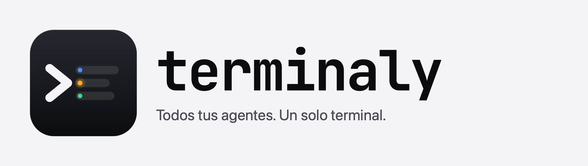
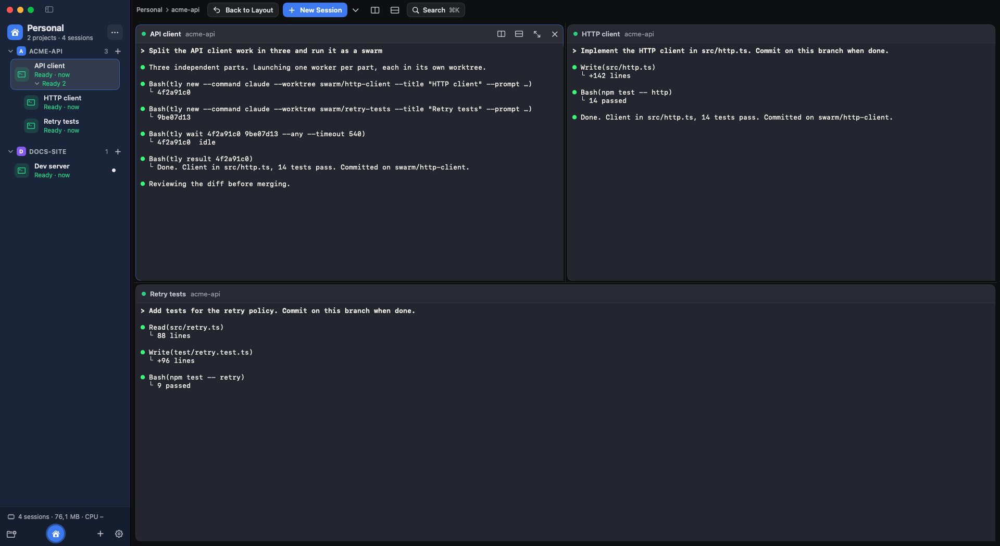
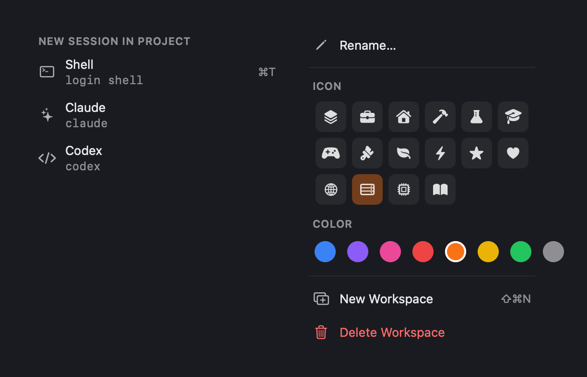

<p align="center">
  <picture>
    <source media="(prefers-color-scheme: dark)" srcset="brand/logo-dark.png">
    
  </picture>
</p>

# Terminaly

Native macOS app (SwiftUI + SwiftTerm) for running and steering CLI agent sessions, inspired by Unpeel.

- Sidebar: projects (folders) → sessions, pin, rename, archive, folder colors, drop folders to add
- Real terminals (SwiftTerm), kept alive while hidden
- Presets (Shell, Claude, Codex…) editable in Settings; ⌘T launches the first one
- Split panes (⌘D right, ⇧⌘D down, ⌘W close), persisted layout
- Agent status: Claude Code hooks → Working / Ready / Needs input, notifications + dock badge;
  other agents use output activity
- Command palette (⌘K), ⌘[ / ⌘] to cycle sessions
- Sessions live in the `tly` host daemon: quitting the app leaves them running and they
  reattach (with recent output replayed) on next launch
- Swarms: an agent can start other agent sessions, each in its own git worktree



Every session is a real terminal and every agent reports its own state. Workers of a swarm
show up nested under the session that started them.

## Interface

The frequent menus are popovers of the app's own, not the native ones, so the rows keep a
readable size and the shortcut sits on the right. The presets you choose here are the
commands Terminaly launches in the session.



## Architecture

- `Terminaly` — SwiftUI app; renders terminals (SwiftTerm `TerminalView`) and forwards input.
- `tly` — one daemon process for all sessions (`tly daemon`, auto-started) plus CLI.
  PTYs via forkpty, kqueue-driven (no polling), 2 MB replay ring per session,
  Claude hook HTTP server on 127.0.0.1 with per-run token, exits after 60 s with no sessions or clients.
  Unix socket `~/Library/Application Support/Terminaly/tly.sock` (0600, same-UID peers only).
- `TerminalyKit` — shared framing protocol and socket helpers.

## CLI

```sh
ln -s "$PWD/build/Terminaly.app/Contents/MacOS/tly" /usr/local/bin/tly
```

`<id>` below is any unique prefix of a session UUID; `tly ls` prints the ids.

### Sessions

```sh
tly ls                              # list sessions (workers nested under their lead)
tly ls --json                       # same, as JSON
tly new --command claude            # start a session; prints its id
tly send <id> "text" --enter        # type into a session and press Enter
tly logs <id>                       # recent output
tly attach <id>                     # attach this terminal (Ctrl-\ detaches)
tly wait <id>                       # block until the session is idle, needs input or exited
tly kill <id>                       # hang up a session
tly rm <id>                         # kill it and forget it
```

`--command` runs in your login shell, so `tly new --command "npm run dev"` works too.
Without it you get a plain shell.

### Asking an agent and reading the answer

```sh
tly ask <id> "text"                 # send, wait for the turn to finish, print the answer
tly result <id>                     # the answer of the last finished turn
```

`tly ask` exits 0 when the agent answered, 2 when it is asking for permission or input,
and 3 on timeout (`--timeout S`). It refuses to run against a session that is already
working, so wait for it first.

```sh
tly wait <id> --timeout 540         # block until the session is done with its turn
tly ask <id> "The tests still fail with X. Fix them and report."
```

### Swarm workers

A session started from inside another one becomes its worker: `tly new` reads
`TERMINALY_SESSION_ID` from the environment. Each worker gets its own git worktree,
so several agents can work on the same repository without stepping on each other.

```sh
# inside a session (the lead):
tly new --command claude --worktree swarm/api-client --title "API client" \
  --prompt "Implement the API client. Commit on this branch when done."
```

- `--worktree BRANCH` creates the branch and a worktree in a folder next to the repository
  (`<repo>.worktrees/<branch>`); the worktree is created by the CLI, never by the daemon.
- `--prompt TEXT` is passed to the agent as its first argument.
- `--title NAME` is the name shown in Terminaly.
- `--no-parent` keeps the new session out of the lead's swarm.
- A worker cannot start workers, and the number of live workers per session is capped
  (6 by default, 1–16, changed in Settings → Agents without restarting the daemon).

```sh
tly wait ID1 ID2 --any --timeout 540 # wait until any of them stops
tly result ID1                       # what that worker reported
tly ask ID1 "Also handle the timeout." # follow up on an idle worker
tly rm ID1                           # remove a worker (tly rm LEAD --tree: a lead and its workers)
```

### Swarm workflow

Terminaly does not orchestrate anything: the lead is an ordinary session that drives the
others with `tly`. Install the `terminaly-swarm` skill from Settings → Agents and ask
your agent for a swarm; it gets the whole procedure. The short version:

```sh
# 1. Commit what the workers need, then launch them all (each in its own worktree).
tly new --command claude --worktree swarm/api-client --prompt "…"
tly new --command claude --worktree swarm/worker-tests --prompt "…"

# 2. Wait for them and collect the reports.
tly wait ID1 ID2 --any --timeout 540
tly result ID1

# 3. Review the branches before merging.
git log --oneline HEAD..swarm/api-client
git diff HEAD...swarm/api-client

# 4. Merge one branch at a time, running the checks after each one.
```

In the app, the workers appear nested under their lead in the sidebar, and
**Show Swarm** opens the lead and its workers in a grid of panels (the screenshot at the top);
**Back to Layout** returns to the panes you had.

Permissions are always approved by you, never by the lead. It also works with opencode 2
(install its status plugin in Settings → Agents).

## Install

```sh
curl -fsSL https://raw.githubusercontent.com/drarekx/terminaly/main/install.sh | bash
```

Installs `Terminaly.app` into /Applications (or ~/Applications) and links the `tly` CLI
(`bash -s -- --no-cli` to skip it). Later versions arrive through the built-in updater.

## Release

```sh
scripts/release.sh 0.2.0 "release notes"
```

Builds, zips and EdDSA-signs the app, writes `appcast.xml`, tags, pushes and publishes the GitHub
release (versioned zip + `Terminaly.zip` for the installer + appcast for Sparkle).
Needs `gh` and the Sparkle private key in the login Keychain.

## Build

```sh
./scripts/bundle.sh          # → build/Terminaly.app
open build/Terminaly.app
```

Enable Claude Code status in Settings → Agents → Install Hooks (edits `~/.claude/settings.json`, backup kept).


## Browser access

Settings → Web opens the sessions of this Mac to any browser on the local network (or the
VPN), behind a token. You can type into the sessions, approve permissions, pause them and
watch memory and CPU. The connection is not encrypted: use it only on your own network and
never forward the port to the internet.


## Split panes

⌘D splits right, ⇧⌘D splits down, ⌘W closes the pane and ⌘↩ zooms it. The layout is
saved per workspace, so it comes back the next time you open the app.


## Self-test

```sh
swift build && TERMINALY_STATE_DIR=$(mktemp -d) .build/debug/Terminaly --selftest
```

Uses the real daemon: hook path → needsInput, output heuristic → working/idle, and a simulated app
relaunch that checks the session survives and its output is replayed.
